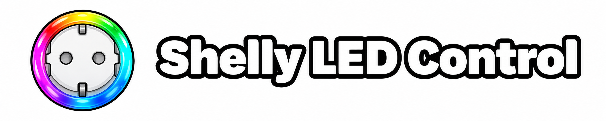

[English documentation](README.md)

# Shelly LED Control

Mit **Shelly LED Control** steuerst du die Status-LED deines Shelly Plus Plug S direkt in Home Assistant. Passe Farben, Helligkeit und Nachtmodus an – lokal im Heimnetz und ohne Cloud-Verbindung. Die Integration ergänzt die offizielle Shelly-Integration von Home Assistant.

## Funktionen

- Status-LED ein- und ausschalten, auch über Dashboards, Szenen und Automatisierungen.
- LED-Anzeige nach Leistungsaufnahme oder Ein/Aus-Zustand der Steckdose wählen.
- Eigene Farben und Helligkeiten für die eingeschaltete und ausgeschaltete Steckdose festlegen.
- Nachtmodus planen, um die LED nachts zu dimmen oder auszuschalten.
- Aktuelle LED-Helligkeit und Nachtmodus-Status anzeigen, mit Helligkeitsverlauf in Home Assistant.

## Unterstützte Geräte

Unterstützt wird der **Shelly Plus Plug S** (`SNPL-00112EU`). Andere Shelly Wall Plugs können funktionieren, werden aber nicht offiziell unterstützt. Dein Shelly muss von Home Assistant im lokalen Netzwerk erreichbar sein.

<!-- ha-marketplace:exclude-start -->

## Installation

### Über den Marketplace

1. Öffne das Repository über die Schaltfläche oben. Alternativ wähle **Einstellungen → Marketplace → Über Link hinzufügen** und gib `https://github.com/jan-brinkmann/ha-shelly-led-control` ein.
2. Verbinde beim Hinzufügen dein GitHub-Konto, wenn der Marketplace dich dazu auffordert. Wähle **Integration**, falls der Typ abgefragt wird.
3. Wähle auf der Seite **Shelly LED Control** die Option **Installieren**. Sobald die Integration bereit ist, öffnet Home Assistant die Einrichtung.

### Manuelle Installation

1. Lade das Quellcode-Archiv der [neuesten Version](https://github.com/jan-brinkmann/ha-shelly-led-control/releases/latest) herunter und entpacke es.
2. Kopiere den Ordner `custom_components/shelly_led_control` in den Ordner `custom_components` deiner Home-Assistant-Konfiguration.
3. Starte Home Assistant neu.

<!-- ha-marketplace:exclude-end -->

## Einrichtung

1. Öffne **Einstellungen → Geräte & Dienste → Integration hinzufügen** und wähle **Shelly LED Control**.
2. Gib den Hostnamen oder die IP-Adresse deines Shelly ein.
3. Behalte den voreingestellten Benutzernamen `admin` bei. Gib das Gerätepasswort ein, wenn der Anmeldeschutz aktiviert ist; andernfalls lasse es leer.

Wiederhole die Einrichtung für jeden weiteren Shelly. Geräte werden manuell hinzugefügt.

## Verwendung

Öffne das Gerät unter **Einstellungen → Geräte & Dienste → Shelly LED Control**. Die Bedienelemente kannst du auch in Dashboards, Szenen und Automatisierungen nutzen.

| Bedienelement | Was du damit machst |
| --- | --- |
| **Status-LED** | LED-Anzeige ein- oder ausschalten. |
| **LED-Anzeigemodus** | **Leistungsaufnahme** oder **Schaltzustand** wählen. Die Auswahl aktiviert die LED-Anzeige. |
| **LED-Farbe bei Relais an / aus** | Farbe und Helligkeit für beide Zustände im Modus **Schaltzustand** einstellen. Die Steckdose selbst wird dabei nicht geschaltet. |
| **Helligkeit Normalbetrieb** | Helligkeit außerhalb des Nachtmodus von 0 bis 100 % einstellen. Im Modus **Schaltzustand** gilt die Änderung für den aktuellen Ein/Aus-Zustand der Steckdose. |
| **Nachtmodus nutzen** | Zeitplan für den Nachtmodus aktivieren. |
| **Beginn / Ende Nachtmodus** und **Helligkeit Nachtmodus** | Zeitfenster und Helligkeit festlegen. Bei 0 % bleibt die LED während des Nachtmodus aus. |
| **Nachtmodus aktiv** | Prüfen, ob der geplante Nachtmodus gerade aktiv ist. |
| **Dimmwert Status-LED** | Aktuelle Helligkeit in Prozent einschließlich Nachtmodus und den Verlauf ansehen. |

Im Modus **Leistungsaufnahme** wählt Shelly die Farbe automatisch; eigene Farben sind im Modus **Schaltzustand** verfügbar. Ist die Steckdose aus, bleibt auch die Leistungsanzeige aus.

Der Nachtmodus richtet sich nach der lokalen Uhrzeit des Shelly und kann über Mitternacht laufen. **Dimmwert Status-LED** wird aus den Geräteeinstellungen und dem Gerätezustand berechnet.

Wenn du auch die offizielle Shelly-Integration nutzt, zeigt Home Assistant einen separaten Geräteeintrag für die LED-Steuerung. Das ist normal.

## Hilfe

- **Keine Verbindung?** Prüfe, ob der Shelly online und seine Weboberfläche aus dem Netzwerk von Home Assistant erreichbar ist.
- **Anmeldung fehlgeschlagen?** Prüfe das Gerätepasswort und nutze die erneute Anmeldung in Home Assistant, wenn sie angeboten wird.
- **Nachtmodus-Status unbekannt?** Prüfe, ob die Uhrzeit des Shelly korrekt eingestellt ist.
- **Einstellungen in der Shelly-Weboberfläche geändert?** Sie werden automatisch in Home Assistant übernommen; bei verzögerter Aktualisierung kann das bis zu fünf Minuten dauern.

Technische Hintergründe findest du unter [Technische Entscheidungen](docs/architecture.md) (Englisch).

## Lizenz

Veröffentlicht unter der [MIT-Lizenz](LICENSE).
