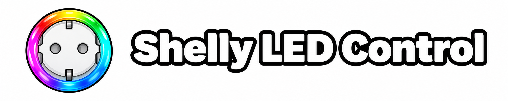

[Deutsche Dokumentation](README.de.md)

# Shelly LED Control

**Shelly LED Control** brings the status LED controls of compatible Shelly plugs to Home Assistant. Depending on the model, you can switch LED indication, adjust its color and brightness, or schedule night mode. The integration works locally alongside Home Assistant's Shelly and Z-Wave JS integrations.

## Features

- Turn the status LED on and off from dashboards, scenes and automations.
- Choose an LED display based on power consumption or the plug's on/off state.
- Set separate colors and brightness for when the plug is on or off.
- Schedule night mode to dim the LED or turn it off at night.
- View the current LED brightness and night-mode status, with brightness history in Home Assistant.

## Supported devices

| Shelly model | Supported LED controls |
| --- | --- |
| Plus Plug S (v1 and v2), Plus Plug UK, Plug S (MTR) Gen3, AZ Plug, Outdoor Plug S Gen3, Plug M Gen3, Plug US Gen4 | On/off, power and switch-state indications, RGB and brightness for each relay state, scheduled night mode and brightness/activity sensors. |
| Plug PM Gen3 | On/off, power or custom-color indication, brightness, scheduled night mode and brightness/activity sensors. Its always-on outlet has one RGB and brightness preset. |
| Plug, Plug E, Plug S, Plug US (Gen1) | Independent on/off controls for network or output indication, according to the settings exposed by the firmware. |
| Wave Plug S, Wave Plug UK, Wave Plug US, Wave Outdoor Plug S, including LR variants | On/off and dimming through Z-Wave JS on firmware that exposes LED intensity parameter 105. |

Plus Plug IT, Plus Plug US and Plug CN Gen3 have status LEDs. Shelly's public APIs for these models do not document a way to configure them.

## Installation

### With HACS (recommended)

1. Install [HACS](https://hacs.xyz) if needed.
2. Open **HACS → Custom repositories** in the three-dot menu. Add `https://github.com/jan-brinkmann/ha-shelly-led-control` as an **Integration**.
3. Download **Shelly LED Control** and restart Home Assistant.

### Manual installation

1. Copy the `custom_components/shelly_led_control` folder into your Home Assistant configuration's `custom_components` folder.
2. Restart Home Assistant.

## Setup

1. Open **Settings → Devices & services → Add integration** and select **Shelly LED Control**.
2. For a Wi-Fi plug, enter its local hostname or IP address. Enter the device credentials if login protection is enabled. The default username is `admin`.
3. For a Wave plug, first pair it with **Z-Wave JS**. Then choose **Wave plug (Z-Wave JS)** in Shelly LED Control and select the paired device.

Repeat these steps for each Shelly you want to add. Devices are added manually.

## Usage

Open the device under **Settings → Devices & services → Shelly LED Control**. Its controls are also available in dashboards, scenes and automations.

| Control | What it does |
| --- | --- |
| **Status LED** | Turns LED indication on or off. On Wave plugs, it also sets the LED intensity. |
| **Network LED / Output LED** | Enables the corresponding LED indication on a Gen1 plug. The light state reflects the enable setting. |
| **LED indication mode** | Selects **Power consumption** or **Switch state**. Selecting a mode enables LED indication. |
| **LED color when relay is on / off** or **Custom LED color** | Sets color and brightness in the corresponding indication mode. The Plug PM Gen3 offers one preset in **Custom color** mode. |
| **Normal brightness** | Sets brightness outside night mode from 0 to 100%. In **Switch state** mode, it sets brightness for the plug's current on/off state. |
| **Use night mode** | Enables the night-mode schedule. |
| **Night mode start / end** and **Night mode brightness** | Set the schedule and brightness. Use 0% to turn the LED off during night mode. |
| **Night mode active** | Shows whether the scheduled night mode is currently active. |
| **Status LED brightness** | Shows the current brightness in percent, including night mode, and provides a history. |

In **Power consumption** mode, Shelly chooses the color automatically. Power-consumption indication goes out when a supported plug's relay is off. The Plug PM Gen3 always supplies power to its outlet.

Night mode follows the Shelly's local time and can run across midnight. **Status LED brightness** is calculated from the device settings and state.

If you also use the official Shelly integration, Home Assistant shows a separate device entry for the LED controls. This is normal.

## Help and updates

- **Cannot connect?** Check that the Shelly is online and its web interface is reachable from the Home Assistant network.
- **Login failed?** Check the device password and use Home Assistant's reauthentication prompt if it appears.
- **Night-mode status is unknown?** Check that the Shelly's clock is set correctly.
- **Changed settings in the Shelly web interface?** They update automatically in Home Assistant; allow up to five minutes if an update is delayed.

Update through HACS and restart Home Assistant when requested. For manual updates, replace the integration folder and restart Home Assistant. Your existing configuration is kept.

For implementation details, see [Technical decisions](docs/architecture.md).

## License

Released under the [MIT License](LICENSE).
